<div align="center">

# Puzzle Lens

**Photograph a scrambled twisty puzzle. Check it in 3D. Follow the solution move by move.**

[](https://www.python.org/)
[](https://pytorch.org/)
[](https://fastapi.tiangolo.com/)
[](https://threejs.org/)
[](LICENSE)

</div>

Take six photos of a scrambled puzzle, one per face, in any order and any way up. Puzzle Lens reads every sticker with neural networks trained only on synthetic renders. It works out which photo shows which face and snaps the readings to the most likely *legal* state. You can check the result on an exact 3D model of the puzzle, and a hierarchical subgroup solver then plays a verified solution back in 3D.

Everything runs on your own machine: a small Python server (vision, decoders, solvers) and a browser app (TypeScript + three.js).

## Supported puzzles

| Puzzle | States | Vision | Solver |
|---|---|---|---|
| **Maltese Gear Cube** (Meffert's) | ≈ 4.5 × 10⁵⁸ | Trained: **99.5%** of synthetic scans exactly right | Ladder solver: a verified solution in about 10–20 s |
| **Tangram Cube Extreme** (DaYan) | 4.75 × 10²⁸ | Trained (v1, experimental): about 67% of synthetic scans exactly right; mistakes can be fixed by hand in the app | Ladder solver: about 90 moves in about 5 s |

The Tangram Cube Extreme changes shape as you turn it, and the scanner reads it in any shape.

## Contents

- [How it works](#how-it-works)
- [Highlights](#highlights)
- [Quick start](#quick-start)
- [Using the app](#using-the-app)
- [Under the hood: Maltese Gear Cube](#under-the-hood-maltese-gear-cube)
- [Under the hood: Tangram Cube Extreme](#under-the-hood-tangram-cube-extreme)
- [Results](#results)
- [Command line and HTTP API](#command-line-and-http-api)
- [Training your own models](#training-your-own-models)
- [Development](#development)
- [Repository layout](#repository-layout)
- [Adding a puzzle](#adding-a-puzzle)
- [Roadmap](#roadmap)
- [Acknowledgements](#acknowledgements)

---

## How it works

```mermaid
flowchart LR
    A["6 photos<br/>any order, any way up"] --> B["Find the face<br/>heatmap CNN"]
    B --> C["Flatten and cut<br/>one crop per sticker"]
    C --> D["Read<br/>colour probabilities"]
    D --> E["Fit the photos together<br/>which face, which way up"]
    E --> F["Decode<br/>most likely legal state"]
    F --> G["Check on the 3D model<br/>fix anything by hand"]
    G --> H["Solve<br/>subgroup ladder"]
    H --> I["Follow along<br/>animated in 3D"]
```



**The 3D engine is the ground truth.** The same engine that draws the puzzle in the browser renders the training photos (so every label is exact), exports the sticker layout the Python side reads, and replays every solution before you see it.

## Highlights

- **Photos in any order, any way up.** Every corner piece shows on three photos, and only one arrangement of the photos makes all of them real pieces. The scanner searches every arrangement and keeps the one that decodes best.
- **Only legal states come out.** The decoder assigns pieces to slots (Hungarian algorithm), then repairs the puzzle's invariants at the lowest cost. For the Tangram, an exact reachability test on the move group (Schreier–Sims) decides legality. Where the decoder overrules the camera, the app marks the sticker.
- **Trained on synthetic photos only.** The datasets are rendered in Chrome by the real 3D model, with random lighting, camera poses, sticker shades, backgrounds and hands. Augmentations add what real cameras do (white balance, blur, noise, JPEG artefacts).
- **Webcam auto-capture.** The networks check the live picture about four times a second. When a new face is held steady and read confidently, the photo is taken automatically.
- **Unusual sticker colours are detected on every scan.** Some cubes put their colours in other places than the model does (a DaYan Tangram has red and orange swapped, and green and blue). The scanner works out each cube's colour layout from its photos, while the solver keeps working in the model's colours.
- **Every solution is verified.** It is replayed on the solver's own tables, then on this repository's model of the puzzle, and again on the 3D model in the browser.

---

## Quick start

**Prerequisites:** Python 3.10+, Node.js 20.19+, and Google Chrome (only needed to render training data). An NVIDIA GPU with CUDA is recommended; everything also runs on the CPU, with slower solves.

### 1. Install

```bash
git clone https://github.com/TirthPatel3223/puzzle-lens.git
cd puzzle-lens

# PyTorch first: choose the build for your machine at https://pytorch.org/get-started/locally/
pip install torch torchvision
pip install -e ".[test]"
pip install pillow-heif            # optional: read iPhone photos (HEIC)

cd web
npm install
npm run build                      # the app the server shows
cd ..
```

### 2. Get the trained models

The networks and solver ladders are about 1 GB unpacked, so they are not stored in git. They belong in `data/` (or wherever `CUBE_SCANNER_DATA` points).

**Option A: download them** from the [latest release](https://github.com/TirthPatel3223/puzzle-lens/releases/latest):

```bash
curl -LO https://github.com/TirthPatel3223/puzzle-lens/releases/latest/download/checkpoints.zip
curl -LO https://github.com/TirthPatel3223/puzzle-lens/releases/latest/download/ladder-maltese.zip
curl -LO https://github.com/TirthPatel3223/puzzle-lens/releases/latest/download/ladder-tangram.zip

# unpack at the repository root (each archive contains its data/... paths)
python -m zipfile -e checkpoints.zip .
python -m zipfile -e ladder-maltese.zip .
python -m zipfile -e ladder-tangram.zip .
```

> On Windows PowerShell, type `curl.exe` instead of `curl`.

| Archive | Download | Unpacked | Unpacks to |
|---|---|---|---|
| `checkpoints.zip` | 193 MB | ~200 MB | `data/checkpoints/` (Maltese `locator.pt`, `reader.pt`), `data/checkpoints/tangram/` |
| `ladder-maltese.zip` | 290 MB | ~540 MB | `data/ladders/learned_r7/` |
| `ladder-tangram.zip` | 251 MB | ~330 MB | `data/ladders/tangram_extreme/learned_r7/` |

**Option B: build them yourself.** See [Training your own models](#training-your-own-models) and [Building the solver ladders](#building-the-solver-ladders).

### 3. Run

```bash
python -m scanner serve --open     # http://127.0.0.1:8000
```

The networks load on the first scan (a few seconds) and each solver on its first solve. Add `--warm` to load the solvers at start-up. To choose a puzzle, use the switcher in the side panel or open `?puzzle=tangram-cube-extreme`.

**What works without the models:**

| Missing | Still works |
|---|---|
| Networks | Practice scrambles, pasting a known state, the legality check, the 3D model, solving |
| Solver ladder | Scanning and checking. For the Tangram, after a practice scramble, the app can still walk you through undoing that scramble |

---

## Using the app

The app has three steps: **Photos → Check → Solve**. The side panel is on the left; drag its edge to resize it, and double-click the edge to reset.

### 1. Photos

- **One photo of each face**, uploaded or taken with the webcam, in any order and any way up.
- **Square-on, filling most of the frame**, with the face's edges in view. Hold the cube or set it on a table, and keep your fingers off the face's edges.
- **Even light**, without strong glare on the stickers.
- **Webcam mode** has a square guide, a focus meter and <kbd>Space</kbd> to capture. The preview is mirrored for a front camera (**Mirror** flips it); the saved photos never are.
- **Auto-capture:** the guide turns **green** when the networks find one new face that fills the square, holds steady and is read confidently. After 3 seconds of green, the photo is taken. Otherwise the guide turns **red** and shows the reason. The thresholds are in `web/src/app/liveCheck.ts`.

There are two other ways in:

- **Practice with a known scramble.** The app gives you a scramble to apply to a solved cube before you take the photos. Because the true state is known, the app can grade the scan, and you can keep the photos as labelled real data.
- **Paste a state** you already have (the Maltese solver's 144-entry array, or a Tangram move sequence).

### 2. Check

Each face is shown as a card: the photo, flattened and turned upright, with a marker on every sticker in the colour the scanner chose.

| Mark | Meaning |
|---|---|
| plain ring | the decoded colour |
| dashed amber circle | the scanner was unsure (under 90%); worth a look |
| amber dot | the decoder overruled the camera to make the puzzle legal |
| blue dot | you changed it |
| red circle | part of a problem that makes the puzzle impossible |
| white line on a gear | where its long teeth point (Maltese) |

**Click any marker to fix it.** The editor shows a zoomed crop, what the camera read and how sure it was, and the colour choices (keys <kbd>1</kbd>–<kbd>6</kbd>). For gears it also shows the four tooth directions.

The **3D model** rebuilds on every change. The **legality check** explains each problem in words and circles the stickers involved. Once the state is legal you can solve it, copy the state, save the scan as JSON, or keep the photos as labelled data.

### 3. Solve

- The app tells you **how to hold the puzzle** and which of your photos goes where.
- Each move is shown large, in notation and in words (*"Left (purple) face: 3 quarter turns counterclockwise"*). It is animated on the model, with the layer that turns next highlighted.
- **Keys:** <kbd>→</kbd> or <kbd>Space</kbd> for the next move, <kbd>←</kbd> to go back, <kbd>P</kbd> to play or pause, <kbd>Home</kbd>/<kbd>End</kbd> to jump. There is also a speed slider, a clickable move list, copy, and download as `.txt`.

<details>
<summary><b>Maltese Gear Cube notation</b></summary>

Hold the cube **blue on top, yellow in front, purple on the left**. The white-green-red corner (back, bottom, right) then never moves. `U`, `L` and `F` are the top, left and front faces. `′` means counterclockwise, and a number repeats the quarter turn: `L'3` is three counterclockwise quarter turns.

</details>

<details>
<summary><b>Tangram Cube Extreme notation</b></summary>

The app uses the simulator's notation (`U U2 U3 U2' U' D … F R L`). `U` and `D` are 60° steps of a corner layer, and `F`, `R` and `L` are 180° edge flips. Each move is named after a piece that never leaves its place, so you can follow a solution whatever shape the puzzle is in:

| Move | Where it is on the puzzle |
|---|---|
| U | the orange-yellow-green corner |
| D | the red-white-blue corner |
| F | the edge with the orange-white middle piece |
| R | the edge with the yellow-blue middle piece |
| L | the edge with the red-green middle piece |

These are the model's colours. For a cube stickered another way, the app gives them in that cube's colours (on a DaYan cube, the `U` corner is red-yellow-blue).

</details>

---

## Under the hood: Maltese Gear Cube

| Stage | What happens | Where |
|---|---|---|
| Find the face | `FaceLocator`: a heatmap network for the four face corners. It looks at the whole photo, then again close up. | `scanner/puzzles/maltese/vision/models.py`, `pipeline.py` |
| Flatten and cut | A homography from the corners, then 13 crops per face (4 stars, 4 gears, 4 edge halves, the centre), each turned to one canonical pose. | `vision/geometry.py` |
| Read | `SlotReader`: one ResNet trunk with a head per slot type. It outputs probabilities for each cell's colour and for each gear's colour and quarter turn, averaged over 5 slightly shifted crops. | `vision/models.py` |
| Fit the photos together | Each photo could be any face, turned 4 ways (120 × 1024 arrangements). A quick score on corner and edge slots picks 24 candidates; those are decoded in full, and the most likely cube wins. | `vision/pipeline.py` (`find_arrangement`) |
| Decode | The most likely **legal** cube under those probabilities. Pieces go into slots by Hungarian assignment, then the invariants are repaired at the lowest cost. A repair that would overrule a confident reading is flagged instead. | `scanner/puzzles/maltese/decode.py` |
| Solve | The state is turned into the solver's frame and mapped to its 144-entry array with a dictionary derived from the move tables. The ladder solver then runs, and each solution is replayed on its simulator. | `scanner/puzzles/maltese/solver.py`, `shared/maltese/solver_map.json` |

The decoder's invariants are proven from the order of the move group (`tools/derive_invariants.py`): a visible arrangement can be reached exactly when they hold.

<details>
<summary><b>Frames and conventions</b></summary>

- **Colours** are indices 0–5: white, yellow, green, blue, red, purple, which are the 3D model's U D F B L R faces (white up, green in front). **The solver numbers them differently:** 0 white, 1 yellow, 2 blue, 3 green, 4 purple, 5 red. `shared/maltese/solver_map.json` translates between the two.
- **A scan is described as it was photographed:** photo 1 is its F face, with that photo's top edge up. The decoder turns it to the **solver's frame**: the white-green-red corner at home, blue up, yellow in front, purple on the left. The solver's U, L, F are the model's B, R, D.
- **A face is a 4×4 grid of cells** (rows down, columns right, seen from outside) plus 4 gears. See `web/src/maltese/observation.ts`.

</details>

## Under the hood: Tangram Cube Extreme

A 60° corner turn tilts pieces out of the cube's outline, so the puzzle changes shape. The scanner reads it in any shape.

| Stage | What happens | Where |
|---|---|---|
| Positions | Every sticker is always in one of **120 positions** (a centre and a normal): 66 on the cube and 54 tilted out. An observation is one value per position: colour 0–5, or 6 for none. | `web/src/tangram/model.ts` → `shared/tangram/layout.json` |
| Find the face | `CornerLocator`: heatmaps for the four corners in the face's own order, with the turning corner third, so it also tells which way up the photo is. | `scanner/puzzles/tangram/vision/models.py` |
| Cut | The camera pose comes from the four corners (IPPE). Each of the face's 29 positions is cut out as a square in its own sticker's plane, so a tilted sticker looks like a flat one. | `vision/geometry.py` |
| Read | `PositionReader`: a ResNet trunk per crop plus a context network for the lighting. It reads 8 classes per position: six colours, **empty** and **hidden** (a sticker is there but something blocks the view). | `vision/models.py` |
| Fit the photos together | All 720 ways to assign the photos to faces are tried, for the usual colours and then for every other colour layout. Six fit equally well (the puzzle's symmetries), but **only one is reachable** with the core fixed. | `vision/pipeline.py` (`find_faces`), `vision/search.py` |
| Decode | Each piece fills one of **45 cells**; a linear assignment places them. An exact reachability test on the move group's stabiliser chain (Schreier–Sims: 0.6 s to build once, 0.65 ms per test) follows. If needed, the cheapest single or double change that makes the state reachable is applied. | `scanner/puzzles/tangram/decode.py`, `scanner/core/permgroup.py` |
| Solve | The bridge matches this repository's 120 positions to the solver's by their frames, and refuses to load unless the solved colours and all seven moves agree. | `scanner/puzzles/tangram/solver.py` |

<details>
<summary><b>Why six face-on photos (and never corner-on)</b></summary>

A *face* is a side of the middle layer, which never changes shape. Every face always shows some flat stickers to square the camera to, and has a **turning corner** (one of the two three-coloured corner pieces, which only ever twist in place). Looking straight at a turning corner, a sticker that a 60° turn has tilted out looks exactly like the flat sticker in its place. This was measured on the 3D model before any training (`web/tests/tangramModel.test.ts` checks the geometry):

| Photos | Look-alike pairs told apart | Pieces hidden from every photo (60 scrambles) |
|---|---|---|
| 2, straight at the turning corners | 2 of 12 (10 pairs overlap 98–100%) | 39 of 60 scrambles had one |
| **6, face-on** | **12 of 12** (no overlap) | **none** |
| 6, face-on but 15° off square | 12 of 12 (at most 28% overlap) | none |

Face-on, every sticker on the cube's outline is seen flat in one photo, and every tilted sticker is seen at 48° in two photos.

</details>

<details>
<summary><b>Cubes stickered another way</b></summary>

Not every cube carries its colours where the model does. A **DaYan Tangram Cube Extreme** has turning corners in **red-yellow-blue** and **orange-white-green**, where the model has orange-yellow-green and red-white-blue. Every sticker is the model's colour with orange↔red and green↔blue swapped. Other cubes may be mirror images, or have different colours opposite each other.

- **One permutation describes it**, the cube's *colour layout*: `paint[c]` is the colour the cube shows where the model shows colour `c` (`scanner/core/colours.py`). The networks read the colours they see. The decoder and the solver stay in the model's colours, so the solver needs nothing new. The app displays everything in the cube's own colours (`web/src/app/palette.ts`).
- **It is worked out on every scan.** Each layout class is tried with every face assignment: 120 classes for the Tangram (720 permutations up to 6 symmetries), and 30 for the Maltese, whose decoder already absorbs whole-cube turns. For the Tangram, all 86,400 combinations take 0.5 s (`vision/search.py`).
- **A usual cube is never relabelled because of a poor photo.** The usual scheme is decoded first. Another layout is accepted only if its answer is legal, clear-cut (margin ≥ 10 nats), and better than the usual one by a prior plus 10 nats. The prior is 12 for a rearrangement like the DaYan's and 16 for a mirror image or different opposite pairs. A layout that falls short is only offered as a suggestion.
- **On the Check step**, one line says so ("Your cube is stickered differently from the usual: orange and red swapped; green and blue swapped"), with *Not right? Change the colours* to re-read the photos with another layout.
- **Kept scans store the layout** and the colours the cube actually shows, so real scans of such cubes train the readers correctly.

Measured on 300 rendered scans (the v1 networks' readings; no retries):

| | Before layout detection | With layout detection |
|---|---|---|
| Usual cubes, exactly right | 67.3% | 67.3% (same answer on every scan; never another layout) |
| Cubes stickered another way, exactly right | 3.3% | 65.3% (rearranged 71%, mirrored 62%, other pairs 63%) |
| A camera that makes red look orange | 62.7% | 62.7% (2 of 300 already-wrong scans get a wrong layout) |
| Three real DaYan webcam scans | doubtful (margins −9, 3, −4.5) | DaYan layout, legal, margins 16, 20, 22 |

</details>

---

## Results

### Maltese Gear Cube

| Test | Result |
|---|---|
| Synthetic single faces (4,000), corners found by the network | 94.3% of faces read with no mistake; edge stickers 99.1%, stars 99.9%, gear turns 99.97% |
| Synthetic whole scans (400), photos shuffled | **99.5% exactly right** after decoding, 0.23 s per scan |
| Synthetic whole scans (400), fixed order | 98.75% exactly right (69.5% before decoding) |
| First real scan (6 iPhone photos, any order) | Every sticker checked by hand agrees with the photos. The decoder fixed 3 places, and the solver found a 299-move solution. |

### Tangram Cube Extreme (v1 networks)

| Test | Result |
|---|---|
| Locator, synthetic validation set | Photo found the right way up 100%; worst corner within 3% of the face's side on 98.8% of photos |
| Reader, synthetic validation set | Colour 96.7%, empty 99.7%, sticker-or-not 99.0% per position |
| Synthetic whole scans (300), usual colours | 67.3% exactly right, 100% decoded to a legal state |
| Real webcam photos | Red stickers are often read as orange. The decoder recovers some of these, and the v2 retrain targets the rest (see [Roadmap](#roadmap)) |

Evaluation reports are written to `data/reports/`.

---

## Command line and HTTP API

```bash
python -m scanner serve [--host 127.0.0.1] [--port 8000] [--warm] [--open] [--beam 4096]

python -m scanner solve --scramble "U R' F2 D"                       # Maltese, in the 3D model's moves
python -m scanner solve --array "0 0 1 ..."                          # Maltese, the solver's 144-entry array
python -m scanner solve --puzzle tangram --scramble "U2 F D' R U3 L"  # Tangram, in the simulator's notation
```

The server mounts each puzzle's endpoints under `/api/<puzzle-id>/`, where the puzzle id is `maltese-gear-cube` or `tangram-cube-extreme`. Interactive docs are at `/docs` while the server is running.

| Endpoint | Purpose |
|---|---|
| `GET /api/puzzles`, `GET /api/health` | The puzzles the server knows, and the status of their networks and solvers |
| `POST …/vision/scan` | Six photos in, a decoded state out (with per-sticker confidence) |
| `POST …/vision/check` | Live webcam check of one frame (nothing is stored) |
| `POST …/vision/locate` | Find the face in one photo |
| `POST …/decode` | Decode or validate an edited state |
| `POST …/from-array` (Maltese), `POST …/from-moves` (Tangram) | Build a state from an array or a move sequence |
| `POST …/solve` | Solve a state; the solution is verified before it is returned |
| `POST …/scans/{id}/confirm` | Keep a checked scan as labelled real data |
| `POST …/solver/load`, `POST …/vision/load` | Warm up the solver or the networks |

---

## Training your own models

The networks are trained only on synthetic photos rendered by the puzzle's 3D model in Chrome, driven by Playwright. The labels come from the engine state, so they are exact.

**Setup for rendering:**

```bash
pip install -e ".[datagen]"        # Playwright
# Uses your installed Google Chrome by default. Otherwise run `playwright install chromium`
# and pass --channel chromium to gen_dataset.py. The Vite dev server is started automatically.
```

Rendering runs at about 160 pictures a second. Rendering is resumable: pictures that already exist are skipped. Keep datasets outside the repository and out of cloud-synced folders. The paths below are only examples.

### Tangram Cube Extreme

```bash
# 1. Render: single faces for training and validation, plus whole six-photo scans for evaluation
python tools/gen_dataset.py --puzzle tangram --out ../puzzle-data/tangram/v1/train --count 60000 --tabs 4
python tools/gen_dataset.py --puzzle tangram --out ../puzzle-data/tangram/v1/val   --count 4000 --start-seed 1000000 --tabs 4
python tools/gen_dataset.py --puzzle tangram --out ../puzzle-data/tangram/v1/scans --scans --count 300 --start-seed 3000000 --tabs 2

# 2. Train (the best checkpoint goes to data/checkpoints/tangram/)
python -m scanner.vision.train locator --puzzle tangram --data ../puzzle-data/tangram/v1 --epochs 10 --log 200
python -m scanner.vision.train reader  --puzzle tangram --data ../puzzle-data/tangram/v1 --epochs 8  --log 200

# 3. Evaluate
python -m scanner.vision.evaluate photos --puzzle tangram --data ../puzzle-data/tangram/v1/val   --out data/reports/tangram_photos_v1.json
python -m scanner.vision.evaluate scans  --puzzle tangram --data ../puzzle-data/tangram/v1/scans --out data/reports/tangram_scans_v1.json
python -m scanner.vision.evaluate real   --puzzle tangram      # labelled real scans kept from the app
```

### Maltese Gear Cube

`--puzzle maltese` is the default.

```bash
python tools/gen_dataset.py --out ../puzzle-data/maltese/v1/train --count 60000 --tabs 4
python tools/gen_dataset.py --out ../puzzle-data/maltese/v1/val   --count 4000 --start-seed 1000000 --tabs 4
python tools/gen_dataset.py --out ../puzzle-data/maltese/v1/scans --scans --count 400 --start-seed 3000000

python -m scanner.vision.train locator --data ../puzzle-data/maltese/v1 --epochs 8
python -m scanner.vision.train reader  --data ../puzzle-data/maltese/v1 --epochs 6

python -m scanner.vision.evaluate faces --data ../puzzle-data/maltese/v1/val
python -m scanner.vision.evaluate scans --data ../puzzle-data/maltese/v1/scans --any-order
python -m scanner.vision.evaluate real                          # labelled real scans kept from the app
```

### Dataset and training options

- `--layouts 0.5` renders half the puzzles in a random colour layout, labelled with the colours shown, so the readers never learn where the usual scheme puts each colour.
- `--wide-shades` varies sticker shades more from cube to cube: reds as far as orange-red and salmon, oranges as far as red-orange. On any one cube, red always stays redder than orange.
- `--headed` shows the browser while rendering. You can also open `web/datagen.html?puzzle=tangram-cube-extreme` with `npm run dev` to see one sample per click with its labels drawn over it.
- The training scripts take `--batch`, `--workers`, `--resume` and `--device`. Use `--device cpu` for a quick smoke test that doesn't touch the GPU.
- Training also simulates real cameras (`scanner/vision/augment.py`): off white balance (including warm webcams that push red toward orange), exposure, blur, shake, low resolution, noise and JPEG compression.

### Building the solver ladders

The solvers come from [**deeprubik-ladder**](https://github.com/TirthPatel3223/deeprubik-ladder). It splits a puzzle into a ladder of subgroups, then solves small rungs with exact tables and large rungs with value networks trained by deep approximate value iteration (the DeepCubeA method). Its code is vendored in `third_party/cube_solver/`, and the built ladders are copied into `data/ladders/`:

```bash
git clone https://github.com/TirthPatel3223/deeprubik-ladder.git ../deeprubik-ladder
# build and train the ladders there: see its README ("Solving the Maltese Gear Cube" / "Solving the Tangram Cube Extreme")

python tools/import_ladder.py --from ../deeprubik-ladder/data/ladders/learned_r7
python tools/import_ladder.py --puzzle tangram --from ../deeprubik-ladder/data/ladders/tangram_extreme/learned_r7
pytest -m solver                   # solve and verify end to end
```

---

## Development

```bash
python -m scanner serve            # API on :8000
cd web && npm run dev              # app on http://localhost:5173 with hot reload; /api is proxied to :8000
```

| Command | What it checks |
|---|---|
| `pytest -m "not solver"` | Decoders, arrangement searches, colour layouts, the APIs (fast, no ladders needed) |
| `pytest` | All of the above, plus solver round trips (needs the ladders; about a minute on a GPU) |
| `cd web && npm test` | The 3D engines, observations, layouts, the solver dictionary, app frames, a real scan's solution |
| `cd web && npm run typecheck` | TypeScript |
| `cd web && npm run export:shared` | Regenerates `shared/maltese/*.json` and `shared/tangram/layout.json` from the engines |

Set `CUBE_SCANNER_DATA` to keep checkpoints, ladders, reports and real scans outside the repository (default: `data/`).

---

## Repository layout

```
scanner/                        Python package
  server.py                     FastAPI app: mounts each puzzle's endpoints at /api/<puzzle id>/
  core/                         shared by every puzzle: photos, colour layouts, lazy loading, permutation groups
  vision/                       shared vision: ResNet and heatmap building blocks, augmentation,
                                and the CLIs  python -m scanner.vision.train|evaluate --puzzle <key>
  puzzles/                      the registry, and one package per puzzle with the same parts:
    maltese/                      layout, decode, solver, api, vision/{geometry,dataset,models,pipeline,train,evaluate}
    tangram/                      layout, decode, solver (bridge), api, vision/{... same, plus search}
web/                            Vite + TypeScript + three.js
  src/app/                      the app shell: steps, photos (upload, webcam, live check), API client
    maltese/, tangram/          each puzzle's UI: photo guidance, Check and Solve screens, 3D view
  src/maltese/, src/tangram/    what each puzzle shows (observations, positions) and its layout export
  src/datagen/                  the synthetic photo studio: shared lighting, rooms, backdrops and hands, plus one folder per puzzle
  src/vendor/                   3D engines and renderers vendored from combinatorics-puzzle-simulator
  tests/                        vitest
shared/                         sticker layouts and solver maps generated from the engines; read by both sides
third_party/cube_solver/        solver vendored from deeprubik-ladder
tools/                          gen_dataset, import_ladder, export_solver_tables, derive_invariants
tests/                          pytest
data/                           not in git: checkpoints, ladders, reports, real scans, caches
```

## Adding a puzzle

Every puzzle goes through the same pipeline (photos → locator → crops → reader → decoder → 3D check → solver), and each part has one place:

1. **Engine:** vendor the puzzle's 3D engine into `web/src/vendor/<puzzle>/`.
2. **What it shows** (`web/src/<puzzle>/`): an observation computed from the engine state, and a layout export for Python. Register it in `web/tools/export-shared.gen.ts`, with tests tying it to the engine.
3. **Server side** (`scanner/puzzles/<key>/`): `layout.py`, `decode.py`, `solver.py`, and `api.py` with `create_service()`. Add it to `REGISTRY` in `scanner/puzzles/__init__.py`. `scanner/core/permgroup.py` gives any puzzle an exact "can the moves reach this?" test from its move permutations.
4. **Vision** (`scanner/puzzles/<key>/vision/`): geometry, dataset, models, pipeline, train and evaluate. The shared parts are in `scanner/vision/common.py`.
5. **Synthetic photos** (`web/src/datagen/<puzzle>/`): extend `StudioBase`, then register the puzzle in `web/src/datagen/main.ts` and `tools/gen_dataset.py`.
6. **App** (`web/src/app/<puzzle>/ui.ts`): a `PuzzleUI` with its photo guidance and its Check and Solve screens. List it in `web/src/app/puzzles.ts`.

**Decide the camera angles first.** Before you render a dataset, measure on the 3D model which views tell apart every state the reader has to read, as was done for the Tangram's look-alike stickers.

## Roadmap

- [ ] **Tangram: retrain on v2 data** (`--layouts 0.5 --wide-shades`) so the readers tell red from orange on real webcams, and evaluate on real scans.
- [ ] **Maltese: measure on real photos.** About 30 practice scrambles kept from the app, scored with `python -m scanner.vision.evaluate real`. Targets: 99.8% per sticker, and 95% of scans needing no manual fix. Fine-tune on real scans if needed.
- [ ] More puzzles.

## Acknowledgements

- **3D engines and renderers** are vendored from [combinatorics-puzzle-simulator](https://github.com/TirthPatel3223/combinatorics-puzzle-simulator) ([try it live](https://tirthpatel3223.github.io/combinatorics-puzzle-simulator/)), commit `c4d0120`, into `web/src/vendor/`. Only the imports were rewritten. Local additions are `MalteseState.fromPoses`, `poseProblems`, `rotated`, the whole-cube rotation table in `moves.ts`, and `rng.ts`.
- **Solvers** are vendored from [deeprubik-ladder](https://github.com/TirthPatel3223/deeprubik-ladder) (`core/` and `puzzles/`, matching commit `d3e5c1b`) into `third_party/cube_solver/`. Its notes are kept beside the code as `UPSTREAM_*.md`.
- The learned rungs follow the approach of [DeepCubeA](https://www.nature.com/articles/s42256-019-0070-z) (Agostinelli et al., *Solving the Rubik's cube with deep reinforcement learning and search*, 2019).
- Built with [PyTorch](https://pytorch.org/), [FastAPI](https://fastapi.tiangolo.com/), [OpenCV](https://opencv.org/), [SciPy](https://scipy.org/), [three.js](https://threejs.org/), [Manifold](https://github.com/elalish/manifold), [Vite](https://vite.dev/) and [Playwright](https://playwright.dev/).

The Maltese Gear Cube and the Tangram Cube Extreme are products of their respective makers; this project is not affiliated with them.

## License

[MIT](LICENSE) © 2026 Tirth Patel
